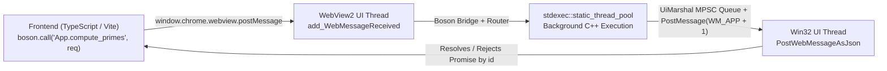

# Boson

**A zero-overhead C++26 WebView2 desktop framework for Windows 10/11.**

Boson pairs bare-metal Win32/COM (`ICoreWebView2`) with compile-time IPC reflection, NVIDIA `stdexec` (P2300 Senders/Receivers) background execution, Windows Fluent Design backdrops, in-memory custom protocol asset serving (`boson://app/*`), and automated TypeScript binding generation—shipping a single LTO-stripped `.exe` (**~1.15 MB** for `boson_demo.exe` with its frontend embedded, ~455 KB zipped) with zero external `WebView2Loader.dll` dependency. The default build links the MSVC runtime dynamically (it needs the VC++ 2015-2026 redistributable); `-DBOSON_STATIC_CRT=ON` makes it fully standalone at ~1.39 MB. Measured sizes and a Boson vs Wails v3 multi-tab benchmark are in [docs/BENCHMARKS.md](docs/BENCHMARKS.md).

---

## Key Features

- **Bare-Metal Win32 & Fluent Design**: Direct `Microsoft::WRL::ComPtr` integration with Per-Monitor V2 DPI awareness, `DWMWA_USE_IMMERSIVE_DARK_MODE`, **headless custom titlebar** (`headless_titlebar`), rounded corners, and Windows 11/10 backdrops (**Mica**, **Mica Alt**, **Acrylic**, **Transparent**, **Translucent**) paired with transparent WebView2 compositing.
- **Native OS Integration (`Boson.*`)**: Built-in `SystemController` exposing window drag/minimize/maximize/close/fullscreen/always-on-top, live backdrop & opacity switching, native Windows notifications (`Shell_NotifyIconW` + `SystemTray`), and COM file/folder dialogs (`IFileOpenDialog` / `IFileSaveDialog`).
- **Non-Blocking Async IPC (`stdexec`)**: Incoming `WebMessageReceived` JSON requests are dispatched onto a lock-free `exec::static_thread_pool` via `stdexec::schedule | stdexec::then` inside `exec::async_scope`, then marshaled back to the Win32 UI thread via `WM_APP + 1`. C++ exceptions are caught at the ABI boundary and returned as structured JSON error responses.
- **Multi-WebView & Browser-Grade Control**: One shared `Environment` (with browser-argument merging and in-place `recreate`) can host many WebViews per window through `WebViewHost`, in windowed or DirectComposition hosting. It provides the full set of navigation, content and lifecycle events, `window.open` into Boson WebViews, tab sleeping (`SleepPolicy`), CSS `app-region` drag and Windows 11 Snap Layouts.
- **Desktop Platform Parity**: Native menus and tray, clipboard, global shortcuts, deep links, monitor API, window-state persistence, file drag-and-drop with real paths, zero-copy shared-buffer IPC, Range streaming, print/PDF, find-in-page, cookies and profiles, WinRT toasts, taskbar and jump lists, power events, auto-launch, capability-based IPC permissions, DPAPI/Credential Manager storage, scoped file system, MSIX/ZIP packaging, signing, a signed auto-updater and crash reporting. Each controller is exposed to TypeScript with generated types.
- **Events & Lifecycle**: Thread-safe `Bridge::emit`/`emit_to` with typed `boson.on`, origin allow-lists, vetoable window close, `WM_DPICHANGED` handling, single instance with argv forwarding, `relaunch`, and graceful `quit`.
- **Compile-Time Reflection Router**: Supports C++26 P2996 static reflection (`<meta>`, `^^T`, `[:member:]`) when available, with a seamless zero-macro [Glaze](https://github.com/stephenberry/glaze) (`v9.1.0`) reflection path that compiles cleanly on MSVC 19.52 today.
- **Zero-Disk-I/O Asset Serving**: Registers `boson://app/*` as a secure custom scheme via `ICoreWebView2EnvironmentOptions4` and serves embedded frontend assets directly from memory using `SHCreateMemStream` + `CreateWebResourceResponse`.
- **Automated TypeScript Bindings**: `boson_tsgen` inspects your reflected C++ controllers and emits `boson-bindings.d.ts` for end-to-end type-safe Promise RPC calls.
- **Vite HMR Dev Mode**: Pass `--dev` (or set `BOSON_DEV_URL=http://localhost:5173`) to develop your frontend with instant Hot Module Replacement while keeping native C++ IPC active.

---

## Architecture



---

## C++26 Compatibility Matrix

Boson is written for C++26 (`/std:c++latest` on MSVC 19.52) with standard-guarded fallbacks where toolchains are still catching up:

| Feature | C++26 Target | Current MSVC 19.52 Path |
| :--- | :--- | :--- |
| Static Reflection | `<meta>` (`__cpp_impl_reflection`) | Glaze `glz::meta<T>` / `glz::reflect<T>` |
| Senders / Receivers | `<execution>` (P2300) | NVIDIA `stdexec` (`nvhpc-26.05`) |
| Binary Embedding | `#embed` (`__has_embed`) | CMake `EmbedAssets.cmake` (`constexpr` byte arrays) |
| Stack Vector | `<inplace_vector>` | `boson::inplace_vector<T, N>` |

---

## Prerequisites

- **OS**: Windows 10 / 11 (x64) with Microsoft Edge WebView2 Runtime installed
- **Compiler**: Visual Studio 2022/2026 with MSVC `19.52+` (`cl.exe` x64)
- **Build Tools**: CMake `3.28+`, Ninja
- **Frontend**: [Bun](https://bun.sh/) (or Node.js / npm)

---

## Quick Start

### 1. Build the Frontend

```powershell
cd frontend
bun install
bun run build
cd ..
```

### 2. Configure & Build Boson (Release with LTO + Stripping)

Run from a PowerShell session after initializing the MSVC x64 environment (`vcvars64.bat`), or invoke it inline:

```powershell
cmd /c '"C:\Program Files\Microsoft Visual Studio\18\Community\VC\Auxiliary\Build\vcvars64.bat" && cmake -B build/release -G Ninja -DCMAKE_BUILD_TYPE=Release && cmake --build build/release'
```

> CMake automatically downloads `Microsoft.Web.WebView2` (`1.0.4370.26`) from NuGet, `glaze` (`v9.1.0`), and `stdexec` (`nvhpc-26.05`).

### 3. Run the Demo & Tests

```powershell
# Run the Release executable (~1.15 MB with the frontend embedded, headless Mica by default)
.\build\release\boson_demo.exe

# Optional flags:
.\build\release\boson_demo.exe --native-frame
.\build\release\boson_demo.exe --backdrop=acrylic
.\build\release\boson_demo.exe --dev http://localhost:5173

# Multi-tab browser example (window.open -> tab, fullscreen, sleeping tabs, screenshare toggle)
.\build\release\boson_browser.exe [--composition] [--screenshare] [url ...]

# Run unit tests (+ WebView2 integration tests; use -LE integration to skip them)
ctest --test-dir build/release --output-on-failure

# Regenerate TypeScript bindings
.\build\release\boson_tsgen.exe frontend\src\generated\boson-bindings.d.ts
```

---

## Minimal Example

### C++ Backend Controller (`examples/demo/app_controller.hpp`)

```cpp
#include <boson/ipc/export.hpp>
#include <glaze/glaze.hpp>

struct PingResult {
    bool pong = true;
    std::int64_t timestamp_us = 0;
};

class AppController {
public:
    BOSON_CONTROLLER("App");

    [[nodiscard]] PingResult ping() const {
        return PingResult{.pong = true, .timestamp_us = 123456};
    }
};

template <>
struct glz::meta<AppController> {
    using T = AppController;
    static constexpr auto value = glz::object("ping", &T::ping);
};
```

### TypeScript Frontend (`frontend/src/boson.ts`)

```ts
import { boson } from './boson';
import type { BosonApi } from './generated/boson-bindings';

const res = await boson.call<ReturnType<BosonApi['App.ping']> extends Promise<infer R> ? R : never>('App.ping');
console.log(res.pong, res.timestamp_us);
```

---

## Documentation

- [Developer Usage Guide](docs/USAGE.md) — Integrating `boson_core`, defining controllers, wiring `Window`/`WebView`/`Bridge`, generating TypeScript bindings, HMR dev mode, and Release LTO builds.
- [Electron & Tauri v2 Gap Analysis](docs/ELECTRON_TAURI_GAP_ANALYSIS.md) — Detailed capability matrix comparing Boson against Electron and Tauri v2, plus the roadmap to full parity.
- Module guides: [Menus & Tray](docs/MENU.md) · [Desktop (clipboard, shell, shortcuts, deep links, screen, window state)](docs/DESKTOP.md) · [Transfer (file drop, binary IPC, streaming)](docs/TRANSFER.md) · [WebView features (print, PDF, find, cookies, profiles)](docs/WEBVIEW_FEATURES.md) · [Security](docs/SECURITY.md) · [Settings store](docs/STORE.md) · [Taskbar, toasts & power](docs/SHELL_INTEGRATION.md) · [Shipping (packaging, signing, updater, crashes)](docs/SHIPPING.md) · [Titlebar](docs/TITLEBAR.md)
- [Migrating from Electron, Tauri v2 and Wails v3](docs/MIGRATION.md) · [Porting shims](docs/PORTING.md) · [Benchmarks](docs/BENCHMARKS.md)
- [Composition & DRM Spike](docs/COMPOSITION_DRM_SPIKE.md) — Composition hosting status, protected-content risks, and a test procedure.
- [Architecture Plan](PLAN.md) — The 5-phase design blueprint for Boson.

## License

MIT — see [LICENSE](LICENSE).
