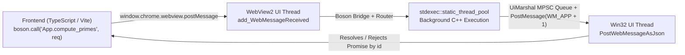

# Boson

**A zero-overhead C++26 WebView2 desktop framework for Windows 10/11.**

Boson pairs bare-metal Win32/COM (`ICoreWebView2`) with compile-time IPC reflection, NVIDIA `stdexec` (P2300 Senders/Receivers) background execution, in-memory custom protocol asset serving (`boson://app/*`), and automated TypeScript binding generation—shipping a self-contained **346.5 KB** LTO-stripped `.exe` with zero external `WebView2Loader.dll` dependency.

---

## Key Features

- **Bare-Metal Win32 & WebView2**: Direct `Microsoft::WRL::ComPtr` integration with Per-Monitor V2 DPI awareness, `DWMWA_USE_IMMERSIVE_DARK_MODE`, optional borderless DWM frames (`WM_NCCALCSIZE` / `WM_NCHITTEST`), and statically linked `WebView2LoaderStatic.lib`.
- **Non-Blocking Async IPC (`stdexec`)**: Incoming `WebMessageReceived` JSON requests are dispatched onto a lock-free `exec::static_thread_pool` via `stdexec::schedule | stdexec::then` inside `exec::async_scope`, then marshaled back to the Win32 UI thread via `WM_APP + 1`. C++ exceptions are caught at the ABI boundary and returned as structured JSON error responses.
- **Compile-Time Reflection Router**: Supports C++26 P2996 static reflection (`<meta>`, `^^T`, `[:member:]`) when available, with a seamless zero-macro [Glaze](https://github.com/stephenberry/glaze) (`v9.1.0`) reflection path that compiles cleanly on MSVC 19.52 today.
- **Zero-Disk-I/O Asset Serving**: Registers `boson://app/*` as a secure custom scheme via `ICoreWebView2EnvironmentOptions4` and serves embedded frontend assets directly from memory using `SHCreateMemStream` + `CreateWebResourceResponse`.
- **Automated TypeScript Bindings**: `boson_tsgen` inspects your reflected C++ controllers and emits `boson-bindings.d.ts` for end-to-end type-safe Promise RPC calls.
- **Vite HMR Dev Mode**: Pass `--dev` (or set `BOSON_DEV_URL=http://localhost:5173`) to develop your frontend with instant Hot Module Replacement while keeping native C++ IPC active.

---

## Architecture



---

## C++26 Compatibility Matrix

Boson is written for C++26 (`/std:c++latest` on MSVC 19.52) with standard-guarded fallbacks where toolchains are still catching up:

| Feature | C++26 Target | Current MSVC 19.52 Path |
| :--- | :--- | :--- |
| Static Reflection | `<meta>` (`__cpp_impl_reflection`) | Glaze `glz::meta<T>` / `glz::reflect<T>` |
| Senders / Receivers | `<execution>` (P2300) | NVIDIA `stdexec` (`nvhpc-26.05`) |
| Binary Embedding | `#embed` (`__has_embed`) | CMake `EmbedAssets.cmake` (`constexpr` byte arrays) |
| Stack Vector | `<inplace_vector>` | `boson::inplace_vector<T, N>` |

---

## Prerequisites

- **OS**: Windows 10 / 11 (x64) with Microsoft Edge WebView2 Runtime installed
- **Compiler**: Visual Studio 2022/2026 with MSVC `19.52+` (`cl.exe` x64)
- **Build Tools**: CMake `3.28+`, Ninja
- **Frontend**: [Bun](https://bun.sh/) (or Node.js / npm)

---

## Quick Start

### 1. Build the Frontend

```powershell
cd frontend
bun install
bun run build
cd ..
```

### 2. Configure & Build Boson (Release with LTO + Stripping)

Run from a PowerShell session after initializing the MSVC x64 environment (`vcvars64.bat`), or invoke it inline:

```powershell
cmd /c '"C:\Program Files\Microsoft Visual Studio\18\Community\VC\Auxiliary\Build\vcvars64.bat" && cmake -B build/release -G Ninja -DCMAKE_BUILD_TYPE=Release && cmake --build build/release'
```

> CMake automatically downloads `Microsoft.Web.WebView2` (`1.0.4370.26`) from NuGet, `glaze` (`v9.1.0`), and `stdexec` (`nvhpc-26.05`).

### 3. Run the Demo & Tests

```powershell
# Run the self-contained Release executable (~346.5 KB)
.\build\release\boson_demo.exe

# Optional flags:
.\build\release\boson_demo.exe --borderless
.\build\release\boson_demo.exe --dev http://localhost:5173

# Run unit tests
ctest --test-dir build/release --output-on-failure

# Regenerate TypeScript bindings
.\build\release\boson_tsgen.exe frontend\src\generated\boson-bindings.d.ts
```

---

## Minimal Example

### C++ Backend Controller (`examples/demo/app_controller.hpp`)

```cpp
#include <boson/ipc/export.hpp>
#include <glaze/glaze.hpp>

struct PingResult {
    bool pong = true;
    std::int64_t timestamp_us = 0;
};

class AppController {
public:
    BOSON_CONTROLLER("App");

    [[nodiscard]] PingResult ping() const {
        return PingResult{.pong = true, .timestamp_us = 123456};
    }
};

template <>
struct glz::meta<AppController> {
    using T = AppController;
    static constexpr auto value = glz::object("ping", &T::ping);
};
```

### TypeScript Frontend (`frontend/src/boson.ts`)

```ts
import { boson } from './boson';
import type { BosonApi } from './generated/boson-bindings';

const res = await boson.call<ReturnType<BosonApi['App.ping']> extends Promise<infer R> ? R : never>('App.ping');
console.log(res.pong, res.timestamp_us);
```

---

## Documentation

- [Developer Usage Guide](docs/USAGE.md) — Integrating `boson_core`, defining controllers, wiring `Window`/`WebView`/`Bridge`, generating TypeScript bindings, HMR dev mode, and Release LTO builds.
- [Architecture Plan](PLAN.md) — The 5-phase design blueprint for Boson.

## License

MIT — see [LICENSE](LICENSE).
